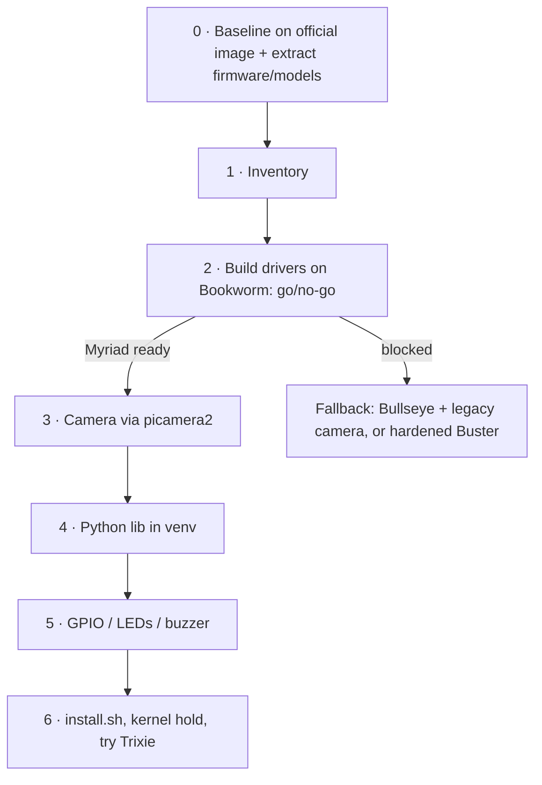

<a href="https://claude.ai"></a>

# AIY Vision Kit v1 on a current Raspberry Pi OS (Bookworm and Trixie)

Goal: run the [Google AIY Vision Kit v1](https://aiyprojects.withgoogle.com/vision-v1/)
(Pi Zero W + Vision Bonnet with Movidius MA2450 + Pi Camera v2) on **Raspberry Pi OS Lite 32-bit
Bookworm** (later Trixie), instead of Google's last image, `aiyprojects-2021-04-02` (Raspbian Buster, kernel 5.10, now out of support).

Status (2026-10-20): **Phase 2 gate passed.** On Bookworm (kernel 6.12) the patched drivers load, the Myriad boots, and still-image
face detection matches the Buster result exactly. **Phase 3:** live camera inference works through picamera2 using the `aiy.camera` shim,
and the boxes line up with the faces. **Phase 5:** LEDs, buzzer, expansion-pin GPIO/PWM and the ADC work, and the Joy Detector runs.
The button works too. **Phase 4+6:** [`port/install.sh`](port/README.md) sets up a whole card (DKMS drivers, firmware/models,
udev, venv, Joy Detector service), and every test passes on the installed system. **Trixie** (kernel 6.18, Python 3.13) works as well: a freshly flashed card set up only by `deploy.sh` passes every test.

**Repository:** <https://github.com/epatel/aiy-vision-kit>

**To install:** see [`port/README.md`](port/README.md). In short:

```bash
git clone https://github.com/epatel/aiy-vision-kit.git && cd aiy-vision-kit
port/fetch-binaries.sh             # Myriad firmware + models from Google's release image
port/deploy.sh pi@<host>           # then reboot the Pi
```
 See [`port/DEPENDENCIES.md`](port/DEPENDENCIES.md). Work through [`TODO.html`](TODO.html); open it in a browser, and your progress is saved locally.

## Why it isn't just `apt upgrade`

| Area | Buster (official) | Bookworm / Trixie |
|---|---|---|
| Kernel | 5.10 | 6.12 / 6.18 — out-of-tree AIY drivers need API fixes |
| Camera | legacy MMAL + `picamera` | libcamera + `picamera2` only |
| GPIO | sysfs, base 0 | chardev preferred, gpiochip base moved (512 on 6.6) |
| Python | 3.7, system pip | 3.11 / 3.13, venv required (PEP 668) |
| Boot config | `/boot/config.txt` | `/boot/firmware/config.txt` |
| Packages | Google apt repo | **gone (404)**, so firmware and models must be pulled from the old image |

## Plan



## Layout

| Path | Contents |
|---|---|
| [`docs/`](docs/README.md) | Reference snapshots: AIY repo, Raspberry Pi docs, picamera2, kernel docs. Read-only. |
| [`TODO.html`](TODO.html) | Interactive checklist with links. |
| [`CLAUDE.md`](CLAUDE.md) | Notes for Claude Code working in this repo. |
| `vendor/` | Binaries saved from the reference card (`aiy-binaries.tgz`: firmware and models) plus `baseline/` logs and photos. Kept out of git. |
| `port/` | `DEPENDENCIES.md` (porting inventory and status), `drivers/` (patched for 6.12 and 6.18), `drivers.patch`, `python.patch`, `install.sh`. |

## Licensing

This repo has no license of its own; each part keeps the license of the code it was derived from:

- `port/drivers/` — derived from Google's AIY kernel drivers: **GPL-2.0** (see each file's header).
- `port/python/` — derived from Google's `aiyprojects-raspbian` Python library: **Apache-2.0** (`docs/aiyprojects-raspbian/LICENSE`).
- `docs/` — unmodified snapshots under their upstream licenses: AIY repo (Apache-2.0 / GPL-2.0), Raspberry Pi documentation
  (CC BY-SA 4.0, `docs/reference/rpi-documentation/LICENSE.md`), picamera2 (BSD-2-Clause), Linux kernel docs (GPL-2.0).
- Not included: the Myriad firmware and models (fetched by `port/fetch-binaries.sh` from Google's release image), and pages whose
  license is unclear (linked from `docs/README.md`).
