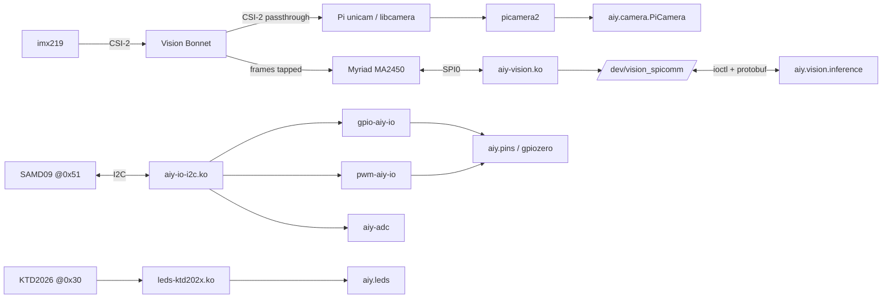

# architecture

How the Vision Kit stack fits together on Raspberry Pi OS Bookworm/Trixie, from camera to Python, and where each piece lives on the Pi.

## Hardware

- **Raspberry Pi Zero W** (ARMv6, 512 MB, `9000c1`): only the **32-bit Lite** image works (no 64-bit build for ARMv6; the desktop is too heavy).
- **Vision Bonnet** on the 40-pin header:
  - **Movidius MA2450 (Myriad 2)** on SPI0, with its own GPIOs for chip select (GPIO8, driven by the driver, not the SPI controller),
    slave-ready IRQ, master error and reset.
  - **SAMD09 MCU** at I2C `0x51`: GPIO expander, PWM, ADC, plus the button LED and buzzer wiring.
  - **KTD2026 RGB LED driver** at I2C `0x30` (button LED + privacy LED).
  - **HAT EEPROM** holding the device-tree overlay, applied automatically at boot (`/proc/device-tree/hat/product` = "AIY VisionBonnet").
- **Pi Camera v2 (imx219)**: its CSI-2 ribbon runs *through* the bonnet, which reads the frames as they pass to the Pi.

## Data flow

- **Inference only runs while the sensor streams in the 1640×1232 binned mode** (old picamera `sensor_mode=4`, libcamera `SRGGB10_CSI2P 1640x1232`).
  Something has to stream (the shim, `rpicam-vid`, anything). The Myriad does the work; the Pi's CPU only moves results.
- `CameraInference` sends the model and a "start camera inference" request over `/dev/vision_spicomm`. `ImageInference` sends a still image instead
  and needs no camera at all, which makes it the quickest check that the Myriad works.
- The Myriad boots from `/lib/firmware/myriad_fw.mvcmd`, loaded by `aiy-vision.ko` at probe. Models (`*.binaryproto`) are loaded per run from `/opt/aiy/models/`.
- Messages to the Myriad are protobuf (`aiy/vision/proto/protocol_pb2.py`, old-style generated code with no `.proto` source). Debian's protobuf 3.21/4.21 still accepts it.

## Kernel modules (DKMS package `aiy-vision-kit`)

| Module | Device | Role |
|---|---|---|
| `aiy-vision` | SPI0 CS0 | Myriad transport, `/dev/vision_spicomm`, firmware load |
| `aiy-io-i2c` | I2C `0x51` | MFD parent for the MCU |
| `gpio-aiy-io` | child | `gpiochip` with lines `AIY_USER0..3`, `AIY_LED0/1`, … |
| `pwm-aiy-io` | child | `pwmchip` for PIN_A..D |
| `aiy-adc` | child | IIO ADC (user pins, supply rails) |
| `leds-ktd202x` | I2C `0x30` | `/sys/class/leds/ktd202x:led1..4` |
| `pwm-soft` | — | software PWM on BCM GPIO 22 for the buzzer, `/sys/class/pwm-soft` |

`aiy-vision` waits for `gpio-aiy-io` (its reset line is an MCU GPIO), so a normal boot logs `Failed to bind reset GPIO: -517` (EPROBE_DEFER)
several times, then `Resetting myriad` → `Writing myriad firmware` → `Myriad booting` → `Myriad ready` about 55–75 s after boot.

## On the Pi after `install.sh`

| Path | What |
|---|---|
| `/usr/src/aiy-vision-kit-2.0.0`, `/lib/modules/$(uname -r)/updates/dkms/` | driver source and built modules |
| `/lib/firmware/myriad_fw.mvcmd`, `/opt/aiy/models/` | firmware and models (from `vendor/aiy-binaries.tgz`) |
| `/opt/aiy/venv` | Python venv, `--system-site-packages` (picamera2, gpiozero, protobuf, Pillow, NumPy all from apt) |
| `/opt/aiy/python` | the `aiy` library and examples, editable install into the venv |
| `/etc/udev/rules.d/60-aiy-*.rules` | `gpio` group access to LED/pwm-soft sysfs; systemd tag for `/dev/vision_spicomm` |
| `/etc/modules-load.d/pwm-soft.conf` | loads `pwm-soft` at boot (nothing in the device tree triggers it) |
| `/boot/firmware/config.txt` | marked block with `dtoverlay=spi0-1cs,cs0_pin=7` (frees GPIO6/8 for the driver) |
| `/etc/systemd/system/joy_detection_demo.service` | the Joy Detector at boot, as the install user, `WorkingDirectory=~` |

## Repo layout

- `port/` is the work: `drivers/`, `python/` (the `aiy` package), `tests/`, `udev/`, `systemd/`, and the scripts `install.sh`, `deploy.sh`,
  `uninstall.sh`, `fetch-binaries.sh`. `drivers.patch` and `python.patch` are diffs against upstream.
- `docs/` holds read-only upstream snapshots: the AIY repo, Raspberry Pi docs (AsciiDoc), picamera2, kernel pages. Each has a `COMMIT` file or `source:` header.
  Don't edit them; re-fetch instead.
- `vendor/` (gitignored) holds `aiy-binaries.tgz`, `cache/` (the downloaded image) and `baseline/` (logs and photos from the original Buster card).
