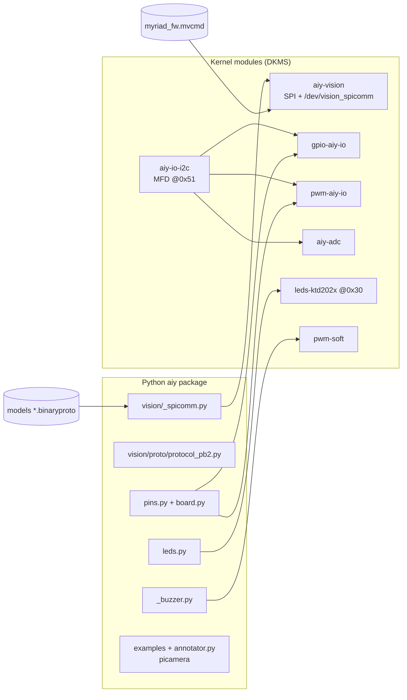

# Dependencies to port: AIY Vision Kit v1 → Raspberry Pi OS Bookworm/Trixie

Phase 1 output (2026-10-20). Target kernel is **6.12** (`rpi-6.12.y`). Bookworm and Trixie both ship it,
and the Pi Zero W uses the `bcmrpi` (ARMv6) build. The baseline is the reference card: 5.10.17+, Python 3.7.3.

Each finding is marked by how it was checked:
- **H**: checked against the `rpi-6.12.y` headers or defconfig fetched from `github.com/raspberrypi/linux` on 2026-10-20.
- **C**: read in the vendored source at `docs/aiyprojects-raspbian/`.
- **?**: not yet checked; confirm on the device.

Source paths below are relative to `docs/aiyprojects-raspbian/`.

## Status: Phase 2 gate passed (2026-10-20)

On the Bookworm card (`pi@vision-kit.local`, kernel `6.12.109+rpt-rpi-v6`, Python 3.11.2):
- `aiy-vision`, `aiy-io-i2c`, `gpio-aiy-io`, `aiy-adc` and `leds-ktd202x` build and autoload at boot.
  They log "Myriad ready" about 56 s after boot, and `/dev/vision_spicomm` is created with mode 0666.
- `face_detection.py --input view2.jpg` gives **exactly** the Buster result (`face_score=0.87744140625`, box `(2613, 679, 436, 436)`).
- Changes: `port/drivers/` (`port/drivers-6.12.patch` is the diff against upstream). Build with `make -C <dir>` on the Pi.
  Install to `/lib/modules/$(uname -r)/updates/aiy/` and run `depmod -a`. DKMS packaging comes in Phase 6.

**Answers to earlier "?" items**
- The HAT EEPROM overlay applies on 6.12 without changes, creating DT nodes for `aiyvision@0`, `aiy-io-i2c@51`, `aiy-gpio` and `ktd2026@30`.
- The bcm2835 gpiochip base **is 512**, which confirms K9b.
- `regmap-i2c` and `industrialio` modules are available.
- **P1 isn't a blocker on Bookworm**: Debian's protobuf 4.21.12 accepts the old `protocol_pb2.py` unchanged. Recheck on Trixie.

**Extra breaks the compiler found (not in the header check)**: the `dev_uevent` callback now takes `const struct device *`.
`spi->cs_gpio` is gone (use `spi_set_csgpiod(spi, 0, NULL)`). `of_match_ptr` needs `<linux/of.h>`, and `gpio_chip` needs `<linux/gpio/driver.h>`.
`iio_dev.driver_module` was removed. The Makefiles used `$(PWD)`, which breaks under `make -C`, so they now use `$(CURDIR)`.

## Status: Phase 3 camera works (2026-10-20)

- libcamera lists the imx219 through the bonnet. Its `1640x1232 SRGGB10_CSI2P` mode (configured as `SBGGR10` with the default
  180° flip) is what the Myriad needs. **No firmware or driver change was needed:** frames reach the bonnet with any client streaming in that mode
  (`rpicam-vid --mode 1640:1232:10:P` or picamera2).
- `aiy/camera.py` (`port/python/src/`) is a picamera-compatible shim on Picamera2 0.3.31. It provides `PiCamera`, `PiCameraCircularIO` and `Color`.
  The examples only change their import (`port/python-bookworm.patch`). Unlike the old library, the sensor starts streaming in the constructor.
- Verified on the device:
  - `face_detection_camera.py` runs at about 8–9 fps (Buster: about 10–15 fps; see "open" below).
  - `camera_face_snapshot.py` boxes line up exactly with the faces in a capture taken at the same time, so orientation and coordinates match Buster.
  - `image_classification_camera.py` and `face_camera_trigger.py` work, and `camera_shim_smoke.py` passes (JPEG/PNG capture, H.264 circular buffer, resolution change).
- Annotator: the MMAL workaround is removed and it now goes through `PiCamera.add_overlay` → `Picamera2.set_overlay`. It only draws while a DRM preview
  is running (with HDMI connected or `AIY_CAMERA_PREVIEW=1`). **Not tested, because there's no display.**
- Open: the fps is lower than Buster's. Likely causes are the CPU cost of the ISP producing RGB888 for the main stream, or the 10–15 vs 8–9
  being noise from a different scene. Try `main` in YUV420 or a smaller size with `lores` when nothing captures; `camera_inference_latency_test.py` can measure it.

## Status: Phase 5 hardware (2026-10-20)

All seven modules build and load at boot (`pwm-soft` through `/etc/modules-load.d/pwm-soft.conf`). `port/tests/hardware_check.py` passes as user `pi`.

- **K8 `pwm-aiy-io`: rewritten.** It now uses `devm_pwmchip_alloc` plus `devm_pwmchip_add`, with `pwmchip_get_drvdata` / `pwmchip_parent`.
  A new `.apply()` maps the atomic state onto the old config/enable/disable steps. Verified: `PWMOutputDevice(PIN_A, frequency=1000).value = 0.25`
  gives `period=1000000 duty=250000 enable=1`.
- **`aiy-adc` EBUSY: fixed.** Every channel had two specs (RAW and PROCESSED) with the same `extend_name`. Newer IIO cores create a
  `*_label` attribute from it, so the second spec collided. They're merged into one spec with both info bits, and the sysfs file names are unchanged.
  It reads `in_voltage4_v3p3_input` = 3301 mV.
- **K9 `pwm-soft`: ported.** Changes: const class-attribute signatures, `ARCH_NR_GPIOS` fallback (1024), `gpio_set_value`, no `class.owner`, and a
  **bounds check on the exported number** (the upstream code indexed the table with unchecked user input). `aiy/_buzzer.py` now converts BCM 22 to the
  kernel number (pinctrl base 512 + 22 = 534). The buzzer plays through `TonePlayer`.
- **udev:** Google's rules (`port/udev/60-aiy-*.rules`) give the `gpio` group access to the LED and pwm-soft sysfs files. Without them, user `pi` gets EACCES.
- **P3 gpiozero 2.0.1:** `HybridFactory` now keeps its own reservation table for `AIYPinSpec` pins and passes the rest to lgpio
  (gpiozero 2 reserves pins through `board_info`). `HatPin` provides `info.name`. `HatFactory` used to return a *closed* cached pin to the next device on
  the same pin; it now creates a fresh one. Also fixed: `pins.py` finds the pwm-aiy-io pwmchip by name instead of hard-coding `pwmchip0`.
- Verified: RGB LED red/green/blue, privacy LED, blink pattern, LEDs off, buzzer, PIN_A GPIO output, LED_1, PIN_A PWM.
  Reading `value` of an output pin returns the MCU's *input* register (0), so the test checks MCU register 0x21 through regmap debugfs instead.
- `joy_detection_demo.py --num_frames 150` runs end to end: model loaded (sound), face found ("Low joy detected"), clean shutdown.
  It needs `fonts-freefont-ttf`, which isn't in Lite.

- Arcade button: `port/tests/button_wait.py` logged 3 of 3 presses (GPIO23 through lgpio, debounced), with the LED switching and a beep on each.

## Status: Phase 6 install (2026-10-20)

`port/install.sh` (run on the Mac through `port/deploy.sh pi@host`) sets up everything above. See `port/README.md`. I tested it on the Bookworm card after
`uninstall.sh` and a reboot (so everything was set up by the script, but the card still had apt packages from development):
- DKMS `aiy-vision-kit/2.0.0` builds all 7 modules in about 10 minutes and installs them to `updates/dkms/`. They autoload, and "Myriad ready" appears about 56 s after boot.
- Python is installed in `/opt/aiy/venv` (`--system-site-packages`, `pip --no-index --no-build-isolation -e /opt/aiy/python`), fully offline.
- Run with the venv's Python, everything passes: `hardware_check.py` all OK, still-image face detection matches Buster exactly, live camera about 10 fps with a face found, and the shim smoke test.
- `joy_detection_demo.service` starts at boot.
- Bugs found while testing: sourcing `/etc/os-release` overwrote the script's `VERSION`, so it's now `AIY_VERSION` and os-release is read in a subshell.
  lgpio creates `.lgd-nfy*` files in the working directory, and a service starts in `/`, so the unit sets `WorkingDirectory=~`.
- Re-running `install.sh` rebuilds DKMS every time (about 10 minutes). A possible improvement is to skip the build when the source hasn't changed.

**Still open**
- **Fresh-flash test (p6-3):** a newly flashed card with only `deploy.sh` run on it. This checks the apt package list catches everything development installed by hand.
- Joy demo photo on button press, the `joy_detection_demo` systemd service, and the streaming server (`--enable_streaming`) haven't been tried.

## Summary

| # | Area | Size of the job | Blocking? |
|---|---|---|---|
| K1–K4 | `aiy-vision` driver | 4 small mechanical fixes | Yes, gate for Phase 2 |
| K5–K6 | `aiy-io-i2c`, `leds-ktd202x` (I2C) | 2 signature changes each | Yes, `aiy-vision` needs `gpio-aiy-io` for its reset GPIO |
| K7 | `gpio-aiy-io`, `aiy-adc` | `remove` → `void` | Yes, same reason |
| K8 | `pwm-aiy-io` | **rewrite to `.apply` and `devm_pwmchip_alloc`** | No, only needed for PWM on the expansion pins |
| K9 | `pwm-soft` (buzzer) | class owner, GPIO numbering | No |
| P1 | protobuf generated code | regenerate, or use a workaround | Yes, for any inference |
| P2 | `picamera` → `picamera2` | 11 files, plus a rewrite of the annotator | Yes, for camera inference (not for `ImageInference`) |
| P3 | gpiozero 2.x pin factory | subclassing a changed API | No, only for buttons and LEDs |

---

## Kernel modules

The Pi kernel config has `CONFIG_GPIO_SYSFS=y`, `CONFIG_PWM=y`, `CONFIG_IIO=m` and `CONFIG_LEDS_CLASS_MULTICOLOR=m` (**H**, `bcmrpi_defconfig`).

### `drivers/vision/aiy-vision.c`: Myriad SPI driver (1,439 lines)

Uses: `module_spi_driver`, `spi_setup/read/write`, `devm_gpiod_get_array` ("vision" and "aiy" GPIO groups),
`gpiod_set_value[_cansleep]`, `gpiod_to_irq` + `devm_request_irq`, `request_firmware("myriad_fw.mvcmd")`,
a chrdev (`alloc_chrdev_region`, `cdev_*`, `class_create`, `device_create`) giving `/dev/vision_spicomm`,
and `mmap` with a `vm_operations_struct.fault` handler.

| ID | Line | Today | 6.12 | Fix | Check |
|---|---|---|---|---|---|
| K1 | 1314 | `class_create(THIS_MODULE, "spicomm")` | `class_create(const char *name)` | drop `THIS_MODULE` | H |
| K2 | 1242 | `vma->vm_flags \|= VM_DONTEXPAND \| …` | `vm_flags` is read-only | `vm_flags_set(vma, VM_DONTEXPAND \| VM_DONTDUMP \| VM_DONTCOPY)` | H |
| K3 | 1282 | `spi_busnum_to_master(0)` sanity check | **function removed** | delete the check: the driver only probes from the DT node on spi0 | H |
| K4 | 1398 | `static int visionbonnet_remove(struct spi_device *)` | `void (*remove)(struct spi_device *)` | return `void` | H |

Not affected: the gpiod descriptor API, `request_firmware`, `copy_{to,from}_user`, `wait_event_interruptible_timeout` and `vm_fault_t` (**C**).
The driver stores private data in `spi->dev.platform_data` (line 1292). That's unusual but still compiles; `spi_set_drvdata` would be cleaner.

Firmware: `/lib/firmware/myriad_fw.mvcmd`, saved in `vendor/aiy-binaries.tgz`.

### `drivers/aiy/aiy/mfd/aiy-io-i2c.c`: bonnet MCU at I2C `0x51` (426 lines)

Uses: regmap-i2c, `mfd_add_devices`, `i2c_lock_bus`, sysfs attribute group, `request_firmware_direct` (MCU firmware update, optional).

| ID | Line | Today | 6.12 | Fix | Check |
|---|---|---|---|---|---|
| K5a | 325 | `probe(struct i2c_client *, const struct i2c_device_id *)` | `int (*probe)(struct i2c_client *)` | drop the second argument; use `i2c_client_get_device_id()` if it's needed | H |
| K5b | 381 | `static int aiy_io_i2c_remove(…)` | `void (*remove)(struct i2c_client *)` | return `void` | H |

`REGMAP_I2C` was loaded as a module on Buster. Confirm that `regmap-i2c` is available on Bookworm (**?**).

### `drivers/leds/leds-ktd202x.c`: RGB button LED at I2C `0x30` (614 lines)

| ID | Line | Today | 6.12 | Fix | Check |
|---|---|---|---|---|---|
| K6a | 544 | two-argument I2C `probe` | one argument | as K5a | H |
| K6b | — | `int` I2C `remove` | `void` | as K5b | H |

**Keep Google's driver.** Mainline has an unrelated `drivers/leds/rgb/leds-ktd202x.c` with the same `kinetic,ktd2026` compatible string,
but `bcmrpi_defconfig` doesn't build it (**H**), so they won't clash. Its sysfs layout is also different from what `aiy/leds.py`
expects (`/sys/class/leds/ktd202x:led1/device/…`, **C**). If a future kernel enables the mainline driver, blacklist it.

### `gpio-aiy-io.c`, `aiy-adc.c`: MFD children

| ID | File:line | Today | 6.12 | Fix | Check |
|---|---|---|---|---|---|
| K7a | `gpio/gpio-aiy-io.c:185` | `static int …_remove(struct platform_device *)` | `void (*remove)` | return `void` | H |
| K7b | `iio/adc/aiy-adc.c:213` | same | same | same | H |

`gpio_chip`: `base = -1` (dynamic) is fine, and `.set` still returns `void` in 6.12 (**H**). Newer kernels change `.set` to return `int`; note this for after 6.12.

### `drivers/aiy/aiy/pwm/pwm-aiy-io.c`: MCU PWM (416 lines), biggest kernel change

| ID | Line | Today | 6.12 | Fix | Check |
|---|---|---|---|---|---|
| K8a | 341–348 | `pwm_ops{.config,.enable,.disable,.owner}` | only `.request/.free/.capture/.apply/.get_state` | implement `.apply(chip, pwm, const struct pwm_state *)` that calls the old config/enable/disable logic | H |
| K8b | 359–365 | `struct pwm_chip` embedded in a private struct, `chip.dev = &pdev->dev` | `pwm_chip` embeds `struct device dev`, there's no `dev` pointer, and `uses_pwmchip_alloc` must be set | `chip = devm_pwmchip_alloc(&pdev->dev, AIY_PWM_PIN_COUNT, sizeof(priv))`, use `pwmchip_get_drvdata()`, and swap `chip->dev` for `pwmchip_parent(chip)` | H |
| K8c | 375 | `int` platform `remove` | `void` | as K7 | H |

### `drivers/pwm/pwm-soft.c`: software PWM for the buzzer on BCM GPIO 22 (439 lines)

| ID | Line | Today | 6.12 | Fix | Check |
|---|---|---|---|---|---|
| K9a | 264 | `struct class { .owner = THIS_MODULE }` | `struct class` has no `owner` | delete the field | H |
| K9b | 196, 358, 423 | `gpio_request(gpio)` and `__gpio_set_value(gpio)`, with the global number written by user space (`_buzzer.py` writes `22`) | legacy API still in `<linux/gpio.h>`, but the bcm2835 gpiochip **base is 512 on 6.6+** (**?**), so `22` no longer means BCM22 | best: convert to `gpiod` with a chip and offset. Quick: add the chip base in `_buzzer.py` | H/? |
| K9c | 395 | `hrtimer_init()` | still exists in 6.12, replaced by `hrtimer_setup()` in newer kernels | leave for now | H |

### Device tree and boot config

- The overlay comes from the bonnet's HAT EEPROM (`/proc/device-tree/hat/product` = "AIY VisionBonnet" on the reference card).
  It targets the labels `&spi0`, `&spidev0`, `&gpio`, `&spi0_cs_pins` and `&i2c_arm`. Check they all still exist in the 6.12 `bcm2708` DT (**?**).
  If they don't, put a fixed `aiy-visionbonnet.dtbo` in `/boot/firmware/overlays/` and set `dtoverlay=` plus `force_eeprom_read=0`.
- `dtoverlay=spi0-1cs,cs0_pin=7` is required (from `HACKING.md`). The driver handles chip-select itself on GPIO8.
- Drop `start_x=1` and `gpu_mem=128`; they're legacy-camera settings. Keep `camera_auto_detect=1`.

---

## Python

### P1: protobuf generated code: `src/aiy/vision/proto/protocol_pb2.py` (**C**)
- Old-style generated code (`_descriptor.FileDescriptor(serialized_pb=_b(…))`). It works with protobuf 3.14 (baseline), but
  Python protobuf ≥ 4.21 refuses it with "Descriptors cannot be created directly". Debian Bookworm's `python3-protobuf` 3.21.x
  comes from the same source as the 4.21 Python runtime, so it will probably fail too (**?**).
- **The `.proto` source isn't in the repo.** Options, best first:
  1. Rebuild `protocol.proto` from the embedded `serialized_pb` (it's a `FileDescriptorProto`; parse it and print it as `.proto`), then run current `protoc`.
  2. Set `PROTOCOL_BUFFERS_PYTHON_IMPLEMENTATION=python` (slow on a Pi Zero, but enough for a first test).
  3. Pin `protobuf==3.20.3` in the venv.
- `src/aiy/vision/streaming/proto/messages.proto` *does* have source, so just regenerate it.

### P2: `picamera` (MMAL) → `picamera2` (libcamera) (**C**)

Files that import picamera:
`aiy/vision/annotator.py`, `examples/vision/{any_model_camera, face_camera_trigger, face_detection_camera, image_classification_camera, mobilenet_based_classifier}.py`,
`examples/vision/joy/joy_detection_demo.py`, `examples/vision/object_meter/object_meter.py`, `examples/vision/video_capture/video_capture.py`,
`tests/{camera_inference_latency_test, engine_test}.py`.

The core library (`aiy/vision/inference.py`, `_spicomm.py`) **doesn't use picamera**. `CameraInference` only needs the sensor streaming.

| picamera usage | Count | picamera2 equivalent |
|---|---|---|
| `PiCamera(sensor_mode=4, resolution=(1640,1232) \| (820,616), framerate=30)` | 9 | `create_video_configuration(main={"size": …}, sensor={"output_size": (1640, 1232)}, controls={"FrameRate": 30})`. The sensor mode is what matters to the bonnet. |
| `start_preview()` / `stop_preview()` | 7 / 4 | `start()` / `stop()` (`Preview.NULL` headless, DRM with HDMI) |
| `resolution` | 6 | config `main.size` |
| `capture(...)` | 3 | `capture_file` / `capture_array` |
| `start_recording` / `wait_recording` / `stop_recording`, `request_key_frame`, `PiCameraCircularIO` | 2 / 2 / 1, 1, 1 | `H264Encoder` + `CircularOutput2` (video_capture, face_camera_trigger) |
| `annotate_text`, `annotate_foreground`, `annotate_background` | 2, 1, 1 | no built-in. Draw with `pre_callback` + `MappedArray`, or skip |
| `add_overlay` + monkeypatching `picamera.mmalobj.MMALPortPool.send_buffer` (annotator) | 1 | `picam2.set_overlay(rgba_array)`, which works with the DRM/Qt preview only. **Rewrite `Annotator`.** |
| `PiCamera(sensor_mode=mode)` looped over modes (`engine_test`) | 1 | `picam2.sensor_modes` |

The open question for Phase 3: the bonnet reads the CSI-2 stream as it passes. With libcamera driving the imx219, check that the
1640×1232 binned mode keeps the same lane count, format and timing as MMAL mode 4 (**?**).

### P3: gpiozero 2.x (**C**, the API change still needs checking)
- `aiy/pins.py` subclasses `gpiozero.Pin` and `gpiozero.Factory` (`HatPin`, `HatFactory`, `HybridFactory`). It also uses
  `gpiozero.threads.GPIOThread` and `Device._default_pin_factory()` (private, line 710). Bookworm ships gpiozero 2.0.x, whose pin and
  factory internals changed from 1.5.1 (baseline) (**?**). Expect to fix the subclasses.
- The default factory on Bookworm is `lgpio` (`python3-lgpio`). `RPi.GPIO` (in `setup.py`) is legacy; drop it.

### P4: sysfs paths used from Python (**C**)

| Path | File | Status on 6.12 |
|---|---|---|
| `/dev/vision_spicomm` + ioctls (`TRANSACT`, `TRANSACT_MMAP`, `RESET`) | `vision/_spicomm.py` | unchanged if K1–K4 are done |
| `/sys/module/gpio_aiy_io/drivers/platform:gpio-aiy-io/gpio-aiy-io/gpio/gpiochip*/base` | `pins.py:95` | base is dynamic, so it's read at runtime. The path should still exist (**?**) |
| `/sys/class/gpio/{export,unexport,gpioN/…}` | `pins.py:203` | still there (`CONFIG_GPIO_SYSFS=y`, **H**) but deprecated |
| `/sys/class/pwm/pwmchip0/…` | `pins.py:278` | **hardcoded `pwmchip0`**. Look it up by device name instead (**?**) |
| `/sys/class/leds/ktd202x:led1/device/…` | `leds.py:45` | depends on keeping Google's ktd202x driver (K6) |
| `/sys/class/pwm-soft/{export,unexport,pwmN/…}` | `_buzzer.py:57` | needs K9, plus the GPIO base offset |

### P5: packaging (**C**)
- `setup.py` `install_requires` pulls in `google-assistant-library`, `google-assistant-grpc`, `google-auth*`, `google-cloud-speech`
  (voice only), `picamera` and `RPi.GPIO`. For vision, keep `gpiozero`, `protobuf` and `Pillow`, and add `picamera2` from apt.
- The Python 3.11/3.13 check found no removed stdlib modules (`imp`, `distutils`, `asyncore`, …) in `src/` (**C**).
- PEP 668: use a venv with `--system-site-packages` so it sees `python3-picamera2` and `python3-libcamera`.

---

## Binary assets (no source)

| Asset | Where | Notes |
|---|---|---|
| `myriad_fw.mvcmd` | `vendor/aiy-binaries.tgz` → `/lib/firmware/` | Myriad firmware; the only copy now that Google's apt repo is gone |
| 9 × `*.binaryproto` | `vendor/aiy-binaries.tgz` → `/opt/aiy/models/` | Compiled models; the paths are in `aiy/vision/models/*.py` |
| Bonnet MCU firmware | (in the EEPROM / not saved) | `aiy-io-i2c` can update it but doesn't need to |

## Suggested order
1. K1–K7 → `dmesg | grep "Myriad ready"` → P1 → `ImageInference` on `vendor/baseline/view2.jpg` (Phase 2 gate).
2. P2: camera through picamera2 (Phase 3).
3. P3, P4, K8, K9: buttons, LEDs, PWM, buzzer (Phase 5).
